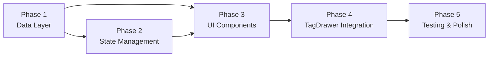

# Caption Library Integration - Main Plan

## Problem Statement

The `BlazorWebApp/Data/captions.csv` file contains 80k+ detailed image captions with metadata (Aspect Ratio, Nudity, Artistic Quality, Erotic Score, Pornographic Score, Males, Females, Clothing). Loading these into the database and managing them through the regular wildcards page is not ideal. The captions need to be accessible directly from the generation flow with filtering capabilities.

## Proposed Solution

Add a **"Caption Library"** tab to the existing [`TagDrawer.razor`](BlazorWebApp/Components/Shared/Generation/TagDrawer.razor) that provides:

- Direct CSV-based browsing of 80k+ captions without database import
- Filter bar with controls for all metadata columns
- Paginated/virtualized caption cards with action buttons
- Full caption text injection into prompts (no LLM processing)
- Filter state persistence in `AppState`

## Key Decisions

| Decision          | Choice               | Rationale                                                            |
| ----------------- | -------------------- | -------------------------------------------------------------------- |
| Data source       | CSV file directly    | Avoids database migration for 80k rows; adapt if performance is poor |
| Caption injection | Full text, no LLM    | Captions are already well-formed descriptive prompts                 |
| Tab location      | TagDrawer (new tab)  | Follows existing pattern (Artists, Characters, Wildcards, etc.)      |
| State persistence | AppState             | Consistent with existing filter state patterns                       |
| Integration scope | Independent tab only | No wildcard or LLM integration in this phase                         |

## Assumptions

1. The CSV file location is stable at `BlazorWebApp/Data/captions.csv`
2. Sylvan.Data.Csv library (already used by [`CsvService.cs`](BlazorWebApp/Services/CsvService.cs)) can handle the captions.csv schema
3. 80k rows in memory is acceptable (~50-100MB RAM) for the initial implementation
4. The drawer tab pattern used by ArtistBrowserPanel/CharacterBrowserPanel/WildcardBrowserPanel applies

## Stress Points

| Risk                               | Impact                  | Mitigation                                            |
| ---------------------------------- | ----------------------- | ----------------------------------------------------- |
| CSV parsing 80k rows on every load | Slow initial render     | Lazy-load + in-memory cache (pattern from CsvService) |
| Filtering 80k rows client-side     | UI freeze during filter | Server-side filtering via service; paginated results  |
| Long caption text in cards         | Layout overflow         | Truncate preview with expansion toggle                |
| Memory pressure with full captions | High RAM usage          | Consider virtualization if needed; start simple       |

---

## Implementation Phases

### Phase 1: Data Layer — Caption Library Service (Fibonacci: 3)

**Goal:** Create a service that loads, caches, and filters captions from CSV.

**Deliverables:**

- [`ICaptionLibraryService.cs`](BlazorWebApp/Services/ICaptionLibraryService.cs) — Interface
- [`CaptionLibraryService.cs`](BlazorWebApp/Services/CaptionLibraryService.cs) — Implementation
- [`CaptionRecord.cs`](BlazorWebApp/Data/Dtos/CaptionRecord.cs) — DTO for a single caption row
- [`CaptionFilter.cs`](BlazorWebApp/Data/Dtos/CaptionFilter.cs) — Filter criteria DTO

**Key Design:**

- Lazy-load CSV on first access (mirrors [`CsvService.cs`](BlazorWebApp/Services/CsvService.cs:20) pattern)
- Cache full dataset in memory; filter in-memory with LINQ
- Pagination support via `Skip`/`Take` on filtered results
- Service registered as singleton in `Program.cs`

**CaptionRecord DTO:**

```csharp
public class CaptionRecord
{
    public int Id { get; set; }                    // Row number (1-based)
    public string Caption { get; set; }            // Full caption text
    public string AspectRatio { get; set; }        // "2:3", "3:2", etc.
    public string Nudity { get; set; }             // "none", "partial", "full"
    public double ArtisticQuality { get; set; }    // 0.0 - 1.0
    public double EroticScore { get; set; }        // 0.0 - 1.0
    public double PornographicScore { get; set; }  // 0.0 - 1.0
    public int Males { get; set; }                 // Count of male subjects
    public int Females { get; set; }               // Count of female subjects
    public List<string> Clothing { get; set; }     // JSON array parsed to list
}
```

**CaptionFilter DTO:**

```csharp
public class CaptionFilter
{
    public string? SearchText { get; set; }           // Full-text search in caption
    public string? AspectRatio { get; set; }          // Filter by aspect ratio
    public string? Nudity { get; set; }               // Filter by nudity level
    public double? MinArtisticQuality { get; set; }   // Minimum artistic quality
    public double? MinEroticScore { get; set; }       // Minimum erotic score
    public double? MaxPornographicScore { get; set; } // Maximum pornographic score
    public int? MinMales { get; set; }                // Minimum male count
    public int? MinFemales { get; set; }              // Minimum female count
    public string? ClothingTag { get; set; }          // Filter by clothing item
}
```

**Success Criteria:**

- [ ] Service loads CSV on first call and caches results
- [ ] Filtering returns correct subsets for each filter dimension
- [ ] Pagination works correctly with filters applied
- [ ] Service registered in DI container

---

### Phase 2: State Management — AppState Integration (Fibonacci: 2)

**Goal:** Persist caption library filter state in `AppState`.

**Deliverables:**

- New class `AppStatePromptsCaptionLibrary` in [`AppState.cs`](BlazorWebApp/Models/AppState.cs)
- Property added to `AppStatePrompts`
- Initialization in `AppSettings` defaults

**Design:**

```csharp
// In AppState.cs
public class AppStatePromptsCaptionLibrary
{
    public CaptionFilterDto Filter { get; set; } = new();
    public int ActiveDrawerTabIndex { get; set; } = 0;
    public int PageSize { get; set; } = 24;
}

// In AppStatePrompts
public AppStatePromptsCaptionLibrary Captions { get; set; } = new();
```

**Success Criteria:**

- [ ] Filter state survives page navigation
- [ ] Page size preference persists
- [ ] Active tab index restored on reload

---

### Phase 3: UI Components — Caption Library Panel (Fibonacci: 5)

**Goal:** Create the caption library panel with filter bar and caption cards.

**Deliverables:**

- [`CaptionLibraryPanel.razor`](BlazorWebApp/Components/Prompts/CaptionLibraryPanel.razor) + `.css` — Main panel component
- [`CaptionFilterBar.razor`](BlazorWebApp/Components/Prompts/CaptionFilterBar.razor) + `.css` — Filter controls
- [`CaptionCard.razor`](BlazorWebApp/Components/Prompts/CaptionCard.razor) + `.css` — Individual caption card

**Component Hierarchy:**

```
CaptionLibraryPanel (container, pagination, data loading)
├── CaptionFilterBar (filter controls, applies to service query)
│   ├── SearchTextField (caption text search)
│   ├── AspectRatioSelect (chip buttons or MudSelect)
│   ├── NuditySelect (chip buttons: none/partial/full)
│   ├── ArtisticQualitySlider (min threshold)
│   ├── EroticScoreSlider (min threshold)
│   ├── PornographicScoreSlider (max threshold)
│   ├── MalesNumericField (min count)
│   ├── FemalesNumericField (min count)
│   ├── ClothingTextField (search clothing array)
│   └── RandomButton (shuffles and inserts random caption matching filters)
├── MudGrid of CaptionCard (results display)
│   ├── Truncated caption preview (2-3 lines max-height)
│   ├── Metadata badges (aspect ratio, quality score, etc.)
│   └── Action buttons: Insert Full / Append
└── PaginationNav (reuse existing component)
```

**UI Design Language Compliance:**

- `Variant.Text` on form controls per [`04-UI-DESIGN-LANGUAGE.md`](Documentation/Architecture/04-UI-DESIGN-LANGUAGE.md:17)
- `Dense="true"` on selects and numeric fields inside filter grid
- `MudStack Spacing="2"` for vertical groups, `MudGrid Spacing="2"` for horizontal
- Long caption text uses the documented overflow pattern (clamped max-height with expansion toggle)

**CaptionCard Design:**

- Compact card showing first ~150 characters of caption with "..." truncation
- Click to expand full caption in a MudExpansionPanel within the card
- Badges: Aspect Ratio, Artistic Quality score, Nudity level
- Two action buttons: "Insert" (replaces prompt) and "Append" (adds to end)

**Random Button Design:**

- Positioned at the right end of the filter bar toolbar row
- Icon: `Icons.Material.Filled.Casino` (dice icon, matching the existing wildcard theme)
- On click: calls `GetRandomCaptionAsync` with current active filters and injects result into prompt via `OnAppendTags`
- Shows a brief snackbar message with the caption's aspect ratio and quality score when inserted

**Success Criteria:**

- [ ] Filter bar controls all render correctly with proper variants
- [ ] Filtering updates results in real-time (debounced search)
- [ ] Pagination navigates through filtered results
- [ ] Caption cards display truncated preview + expandable full text
- [ ] Insert/Append actions fire `OnAppendTags` callback
- [ ] Random button returns a caption matching active filters

---

### Phase 4: TagDrawer Integration (Fibonacci: 2)

**Goal:** Add the Caption Library tab to the existing TagDrawer.

**Deliverables:**

- Updated [`TagDrawer.razor`](BlazorWebApp/Components/Shared/Generation/TagDrawer.razor) with new tab
- Wire up `OnAppendTags` event callback pattern (matching existing tabs)

**Changes:**

```razor
<!-- New tab added after Tag Groups, before LLM Enhancer -->
<MudTabPanel Text="Captions" Icon="@Icons.Material.Filled.LibraryBooks">
    <CaptionLibraryPanel OnAppendTags="OnAppendTags" />
</MudTabPanel>
```

**Success Criteria:**

- [ ] Tab appears in TagDrawer with correct icon and label
- [ ] Opening the drawer to Captions tab loads data
- [ ] Insert/Append from Caption Library flows through TagDrawer to PromptsForm
- [ ] No regression in existing tabs

---

### Phase 5: Testing & Polish (Fibonacci: 2)

**Goal:** Verify performance, fix edge cases, and polish UX.

**Checklist:**

- [ ] Load time for 80k captions measured (< 2 seconds target)
- [ ] Filter combinations tested (all filters active simultaneously)
- [ ] Empty result state handled (show message when no captions match)
- [ ] Caption injection into prompt field verified on Generate page
- [ ] Negative prompt drawer also supports caption library (via IsNegativePrompt parameter passthrough for header coloring if needed)
- [ ] Mobile/responsive behavior checked in 45vw drawer width

**Success Criteria:**

- [ ] No console errors or warnings
- [ ] Smooth scrolling through paginated results
- [ ] Filter state persists across navigation

---

## File Structure Summary

```
BlazorWebApp/
├── Data/
│   ├── captions.csv                              (existing data source)
│   └── Dtos/
│       ├── CaptionRecord.cs                      (NEW - Phase 1)
│       └── CaptionFilter.cs                      (NEW - Phase 1)
├── Models/
│   └── AppState.cs                               (MODIFIED - Phase 2)
├── Services/
│   ├── ICaptionLibraryService.cs                 (NEW - Phase 1)
│   └── CaptionLibraryService.cs                  (NEW - Phase 1)
├── Components/
│   └── Prompts/
│       ├── CaptionLibraryPanel.razor              (NEW - Phase 3)
│       ├── CaptionLibraryPanel.razor.css          (NEW - Phase 3)
│       ├── CaptionFilterBar.razor                 (NEW - Phase 3)
│       ├── CaptionFilterBar.razor.css             (NEW - Phase 3)
│       ├── CaptionCard.razor                      (NEW - Phase 3)
│       └── CaptionCard.razor.css                  (NEW - Phase 3)
├── Components/Shared/Generation/
│   └── TagDrawer.razor                           (MODIFIED - Phase 4)
└── Program.cs                                    (MODIFIED - Phase 1)
```

## Dependencies Between Phases



## Total Complexity: 14 Fibonacci Points

| Phase | Description                             | Points |
| ----- | --------------------------------------- | ------ |
| 1     | Data Layer — Caption Library Service    | 3      |
| 2     | State Management — AppState Integration | 2      |
| 3     | UI Components — Caption Library Panel   | 5      |
| 4     | TagDrawer Integration                   | 2      |
| 5     | Testing & Polish                        | 2      |

---

## Appendix: CSV Schema Reference

Based on [`captions.csv`](BlazorWebApp/Data/captions.csv):

| Column             | Sample Value                               | Notes                                 |
| ------------------ | ------------------------------------------ | ------------------------------------- |
| Caption            | "Alice lies on a bed covered with..."      | Long descriptive text (100-500 words) |
| Aspect Ratio       | "2:3", "3:2", "1:1", "16:9"                | Enum-like values                      |
| Nudity             | "none", "partial", "full"                  | Categorical filter                    |
| Artistic Quality   | 0.45, 0.65, etc.                           | Float 0-1, higher = better            |
| Erotic Score       | 0.65, 0.70, etc.                           | Float 0-1                             |
| Pornographic Score | 0.25, 0.00, etc.                           | Float 0-1                             |
| Males              | 0, 1, 2, etc.                              | Integer count                         |
| Females            | 1, 2, etc.                                 | Integer count                         |
| Clothing           | "['blanket', 'sheet', 'top', 'underwear']" | JSON array string                     |
